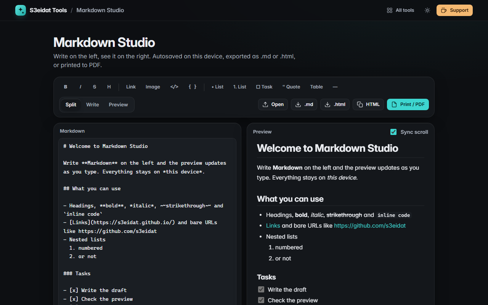

# Markdown Studio

> A live Markdown editor with a safe preview and export. Free, private, and it runs entirely in your browser.

### ▶ [Open Markdown Studio](https://s3eidat.github.io/markdown-studio/)



## Features

- **Split view** editor and preview (or write-only / preview-only), with **sync scroll**
- Own renderer (`md.js`, no libraries): headings (ATX and setext), **bold**, *italic*, ~~strikethrough~~, inline code,
  fenced and indented **code blocks**, **nested lists**, **task lists**, **tables** with column alignment,
  blockquotes, horizontal rules, links, bare URLs, `<autolinks>`, images and hard line breaks
- **Toolbar** and shortcuts: Ctrl+B bold, Ctrl+I italic, Ctrl+K link
- **Autosaves** to this device as you type
- **Export** `.md` or a standalone `.html` file, copy the HTML, or **Print / Save as PDF**
- Word count and reading time

## Safety

The preview never runs anything you paste:

- **All raw HTML is escaped** and shown as text. `<script>`, ``, `<iframe>` and friends are inert.
- Links may only be `http:`, `https:`, `mailto:` or relative; images only `http(s)` or relative.
  `javascript:`, `data:`, `vbscript:` and obfuscated variants (mixed case, tabs, control characters) are shown as
  struck-through text instead of links.
- Remote images are not loaded in the preview (the page's Content-Security-Policy blocks them); a placeholder with the
  alt text is shown. Exported HTML files do include them.
- A built-in self-test feeds known XSS payloads through the renderer and fails if any element, attribute or URL outside
  the allowed set comes out.

## Privacy

Your writing never leaves your device. There is no server, no account, no analytics.
The page ships with a strict Content-Security-Policy (`connect-src 'self'`), so the browser
itself blocks any attempt to send data anywhere.

## Run it yourself

It's plain HTML, CSS and JavaScript with no build step:

```bash
git clone https://github.com/s3eidat/markdown-studio
cd markdown-studio
python -m http.server 8000
```

Then open http://localhost:8000.

## Support

If this saved you time, **[buy me a coffee ☕](https://s3eidat.github.io/coffee/)**. It keeps every tool free.

---

Part of **[S3eidat Tools](https://s3eidat.github.io/)**: 100+ free, private tools that run in your browser. MIT licensed.
